<div align="center">

# ⚔️ Myth Forge

**A Commander deck builder and collection manager that runs on your own machine.**

Track the cards you own · build legal 100-card decks from them · find out if a deck is on level for your pod
· and, if you like, reskin the whole thing into your own world and print it.

[](https://github.com/onemorethan0/mythforgemtg/actions/workflows/ci.yml)
[](https://github.com/onemorethan0/mythforgemtg/releases)
[](LICENSE)
[](https://www.python.org/)
[](#quick-start)

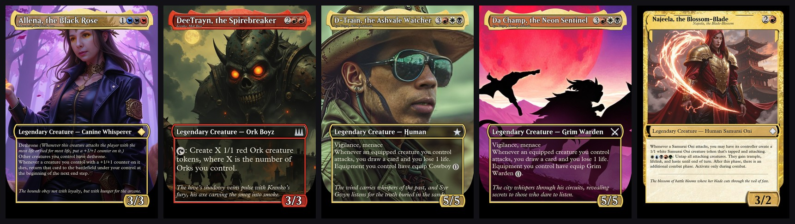

</div>

No accounts, no API keys, nothing uploaded. Card data comes from [Scryfall](https://scryfall.com);
everything else (your collection, your decks, the strength simulator, the optional AI art) lives
on your computer.

---

## Contents

- [What it does](#what-it-does)
- [Quick start](#quick-start) (no GPU needed for building and collection)
- [Your collection](#your-collection)
- [Building a deck](#building-a-deck)
- [Working on a deck](#working-on-a-deck)
- [Is it on level for my pod?](#is-it-on-level-for-my-pod)
- [Importing a deck you already have](#importing-a-deck-you-already-have)
- [Worked examples](#worked-examples)
- [Make it look like your world](#make-it-look-like-your-world) (themed art and proxies)
- [Requirements and services](#requirements-and-services) · [Documentation](#documentation) · [Credits & legal](#credits--legal)

---

## What it does

| | | |
|---|---|---|
| 🎴 | **Keep your collection** | A binder of every card you own, with the exact printing, finish and market price. Import from Moxfield, ManaBox or a pasted list. |
| 🃏 | **Build decks** | Pick a commander, a power bracket and a playstyle; get a legal 100-card list drafted by role and by what actually works with *that* commander. Optionally build only from cards you own. |
| 🛠️ | **Tune decks** | Group by type or role, check legality, edit by hand, draw sample hands, see what the deck costs to finish. |
| 📊 | **Measure decks** | A bundled simulator plays thousands of games to estimate the deck's bracket, kill speed and weaknesses, and checks whether your pod's decks will have a good game together. |
| 🎨 | **Reskin and print** *(optional)* | Rename every card into a world you describe, paint new art locally, and export print-ready proxies. |

---

## Quick start

**1. Install** (once, 2–5 minutes)

```bash
python install.py
```

Windows users can double-click `setup.bat` instead. This installs the Python and frontend
dependencies, builds the frontend and creates the folders the app needs.

**2. Start it**

```bash
python server.py
```

On Windows, double-click **`START MYTH FORGE.bat`**. It starts the local LLM (port 8010) and the
strength engine (port 8020), then serves the app. Open **http://localhost:8000**.

**3. Check everything is up** (optional)

```bash
python verify-setup.py
```

> **You don't need a big GPU to use the deck builder or the collection.** Building, importing,
> editing, legality, prices, sample hands and the collection all work without image generation.
> Turn **Generate AI art** off and cards are shown with their real Scryfall art. A GPU and the
> models from `python download-models.py` are only needed for the custom-art features in
> [Make it look like your world](#make-it-look-like-your-world).

For the strength simulator's full card data, also run `python download-ccm.py` (see
[Is it on level for my pod?](#is-it-on-level-for-my-pod)).

Full instructions and troubleshooting: **[INSTALL.md](INSTALL.md)** ·
**[docs/MAINTENANCE.md](docs/MAINTENANCE.md)**

---

## Your collection

From the home screen choose **🎴 My Collection**.

### Getting your cards in

There are three ways, and they can be mixed:

- **Add one card** by typing its name in the search box at the top.
- **⇪ Bulk import** a Moxfield CSV export or any plain decklist. Choose **Merge** to add to what you
  have, or replace the collection outright.
- **Scan them.** Myth Forge reads and writes the shared Myth Suite collection file
  (`Documents/MythSuite/collection.csv`), the same file [MythScanner](#the-myth-suite) writes when
  you scan physical cards with a webcam.

Both of these import formats work:

```text
Count,Name,Edition,Collector Number
1,Sol Ring,C21,263
4,Llanowar Elves,DOM,168
1,Arcane Signet,,
```

```text
1 Sol Ring (C21) 263
1x Command Tower (ltc) 273
12 Forest
```

The set and collector number are kept, so the same card from two different sets stays as two
separate entries. A card with no set is recorded with its cheapest printing until you say otherwise.

### Browsing it

<p align="center">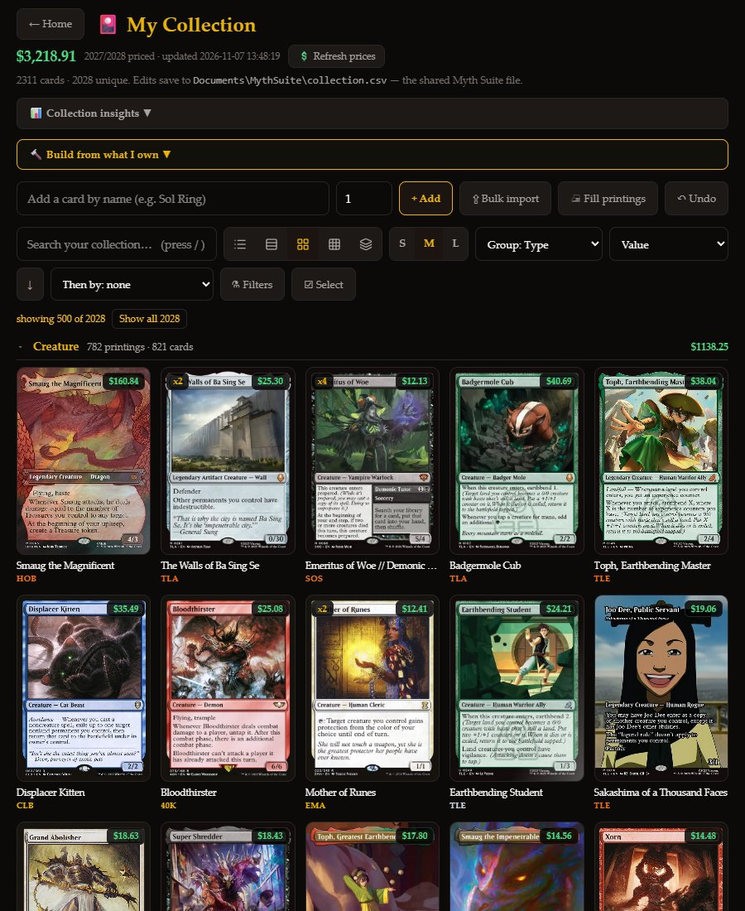</p>
<p align="center"><sub>Grid view, grouped by type and sorted by value. Every tile is the exact printing owned, with its set and price.</sub></p>

- **Five views:** a list with a column chooser, a dense compact list, a card grid (S/M/L), art tiles,
  and overlapping stacks.
- **Group by** type, colour, mana value, rarity, set, finish, or *card* (every printing of a card
  together). Each group shows its own count and value.
- **Sort** by name, value, price, copies, mana value, type, set, popularity, rarity, colour,
  release date, collector number, date added or finish, with a second sort underneath.
- **Filter** by colour, type, rarity, set, mana value, finish, treatment, language, or "owned in 2+
  printings".
- **Stats:** colour presence, mana curve (lands excluded), type and rarity breakdown, and your most
  valuable cards.

<p align="center">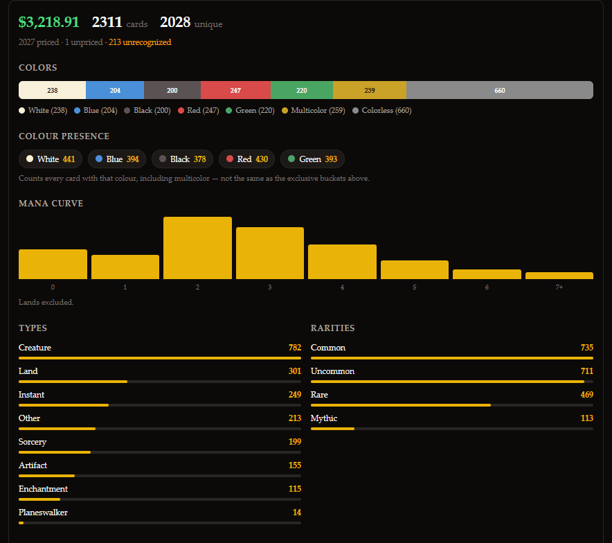</p>

### Printings, foils and prices

Every card shows the printing you own: its art, a rarity-coloured set chip, a foil or etched sheen,
and a flip button for double-faced cards. Foil and nonfoil copies are separate rows. If a printing
isn't known yet the art is marked *representative*; open the **printing picker** (it shows prices per
finish) or press **Fill printings**, which never overwrites a printing you already recorded.

**Refresh prices** pulls current Scryfall USD prices for the whole collection in one batch. Set data
comes from a local copy of Scryfall's bulk file, refreshed weekly, so browsing needs no network.

### Keeping it clean

- A **health check** finds broken rows, such as a whole decklist line pasted into the name field
  (`13x Island (msh) 290 *F* [Land]`), and offers to repair them.
- Every change keeps a backup, and **Undo** restores the collection as it was before the last change.
- Change copies, printing or remove a card right from the list, or select several and act on them
  at once.
- **Copy as a decklist** to paste your collection into Moxfield or Archidekt.

### What can I build from this?

The **Build from what I own** panel scans your collection and ranks the commanders you own by how
much of a real deck your on-colour cards can already fill. Each one has two buttons:

- **Build this →** builds the deck from your cards first and fills any gaps with staples.
- **🎴 Only cards I own** builds strictly from your collection.

<p align="center">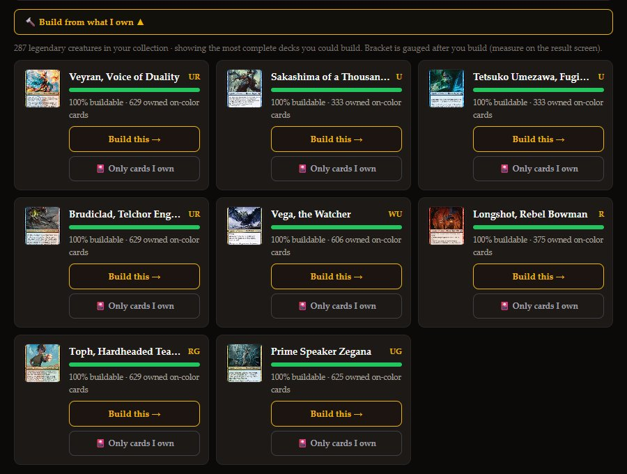</p>

More detail on the build modes: [docs/COLLECTION_MODES.md](docs/COLLECTION_MODES.md).

---

## Building a deck

From the home screen choose **🃏 Build a Deck**.

**1. Commander.** Search any legendary creature (or other legal commander). Partners, *Partner
with*, *Friends forever*, Backgrounds and Doctor's companions are all supported, and a
*Partner—group* card pairs only within its group.

**2. Power bracket (1–5).** The official Commander brackets
gate what the builder may draft: Game Changers, two-card combos, mass land denial, extra turns and
the strongest land tiers are held to what your bracket allows.

**3. Playstyle.** Auto, Aggro, Midrange, Control, Combo, Lifegain, Spellslinger, Recursion, Tokens,
Counters, Voltron, Aristocrats, ETB, Landfall or Tribal. The playstyle shifts how many slots go to
each role.

**4. Card source.** Tick **Build from my collection** to use what you own:

| Mode | Draws from | When your cards run out |
|---|---|---|
| Normal | Every legal card | n/a |
| Build from my collection | Your cards first, then the rest of the format | Staples fill the gaps |
| Only cards I own | Your cards, plus basic lands | The deck tells you which roles came up short, and says so if it padded with basics |

### How the 99 are chosen

The builder drafts by **functional role**: ramp, card draw, removal, board wipes, protection,
finishers and theme cards, then lands. Inside each role, cards are ordered by how much more often
decks with **this commander** play them than decks in general (EDHREC lift), not by global
popularity, so a Krenko deck gets goblin payoffs before generic good stuff. The curve is checked as
it goes, so the deck can actually cast what it drafted.

If you just want a list, continue past the Face and Theme steps with **Generate AI art** off. The
deck page appears with real card art and everything in the next section works.

---

## Working on a deck

Every deck, built or imported, opens on the same page. Everything you build is saved in **📚 Deck
History**, and every rebuild or fix writes a *new* deck, so you never lose the original.

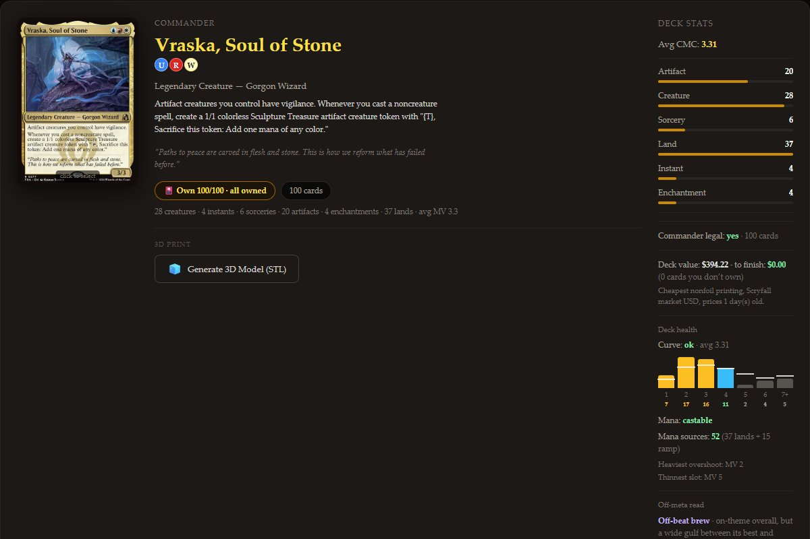
<p align="center"><sub>An imported Archidekt deck. The badge says every card is owned, so the cost to finish is $0; legality, curve and mana sources sit beside it.</sub></p>

| Tool | What it does |
|---|---|
| **Organize by** | Group the 100 by card type, role (ramp, draw, creature removal, other removal, wipes, counterspells, tutors, finishers, lands), colour or mana value. |
| **Deck health** | Mana curve, average mana value and colour sources: can this manabase cast the deck's hardest colour demands on curve? |
| **Commander legal** | Checks deck size (100 with the command zone), singleton, colour identity and the ban list. If something is wrong, the fix shows a dry run first and saves the legal deck as a new copy. |
| **✏️ Edit deck** | Add or cut cards by name. Edits are checked for colour identity, the ban list and singleton, and the deck stats are recomputed. |
| **🎴 Sample hand** | Draw an opening seven, mulligan, draw the next card, plus the exact odds of an opening hand holding 2–4 lands. |
| **Deck value** | What the deck is worth, and what it would **cost to finish** counting only the cards you don't own. Cards you own are badged in the list. |
| **Archetypes & off-meta read** | Which strategies the 99 actually support (only reported when they're statistically real), and how far the deck sits from what this commander usually plays. |
| **Export** | A **Decklist** of the real card names that pastes into Moxfield, Archidekt or back into Myth Forge; card images as a ZIP; a print-ready PDF. |

**Organized by role.** Each role shows what the deck runs against what a typical deck runs, so
"Card draw (7 / 16)" is a gap you can see at a glance:

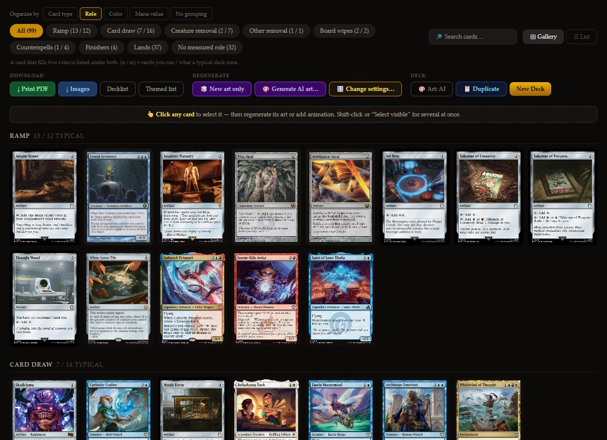

**Deck breakdown.** Role counts against typical, what your removal can actually answer, and how
often the deck casts its hardest colour demands on curve:

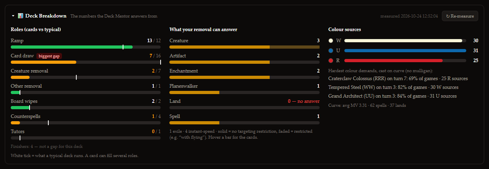

**Sample hand.** Draw, mulligan and draw again, with the exact land odds for this list:

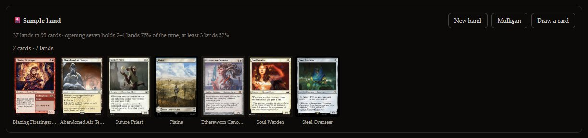

---

## Is it on level for my pod?

The **MythGauntlet** engine (`src/mythgauntlet/`) ships with the app and runs as a separate service.
It plays the deck thousands of times and reports what it saw, so "is this on level for my pod?" gets
an answer instead of a guess.

- **Simulated bracket**, shown next to the bracket you asked for, with the reasons: Game Changers,
  combos and the gates that fired.
- **How fast it kills**, unopposed and against a table, as a range, plus each combo's clock.
- **Strengths and weaknesses** against other decks at the same bracket, and the cards pulling the
  most and least weight.
- **Table feel:** how salty the deck is likely to feel to play against (community salt scores), and
  what it denies other players.
- **Pod check:** add up to three other decks (from your library or pasted) and it flags power, pace,
  denial and predictability mismatches before game night.
- **Head-to-head test:** a 1v1 win rate against a friend's pasted decklist.
- **Upgrade advisor:** tests cards **you already own** in the deck by re-simulating, and suggests
  what to add and what to cut. Cuts come from roles the deck has too many of, not from your least
  popular cards, which are usually your pet cards.
- **Card impact:** would this one card help or hurt the deck, and why.
- **🧙 Ask the Mentor:** ask plain questions ("why does my curve feel bad?") and get answers built
  from the deck's measured numbers. Answers the mentor can't back up are marked unverified.

<details open>
<summary><b>A full strength report</b> (the same deck as above; click to collapse)</summary>

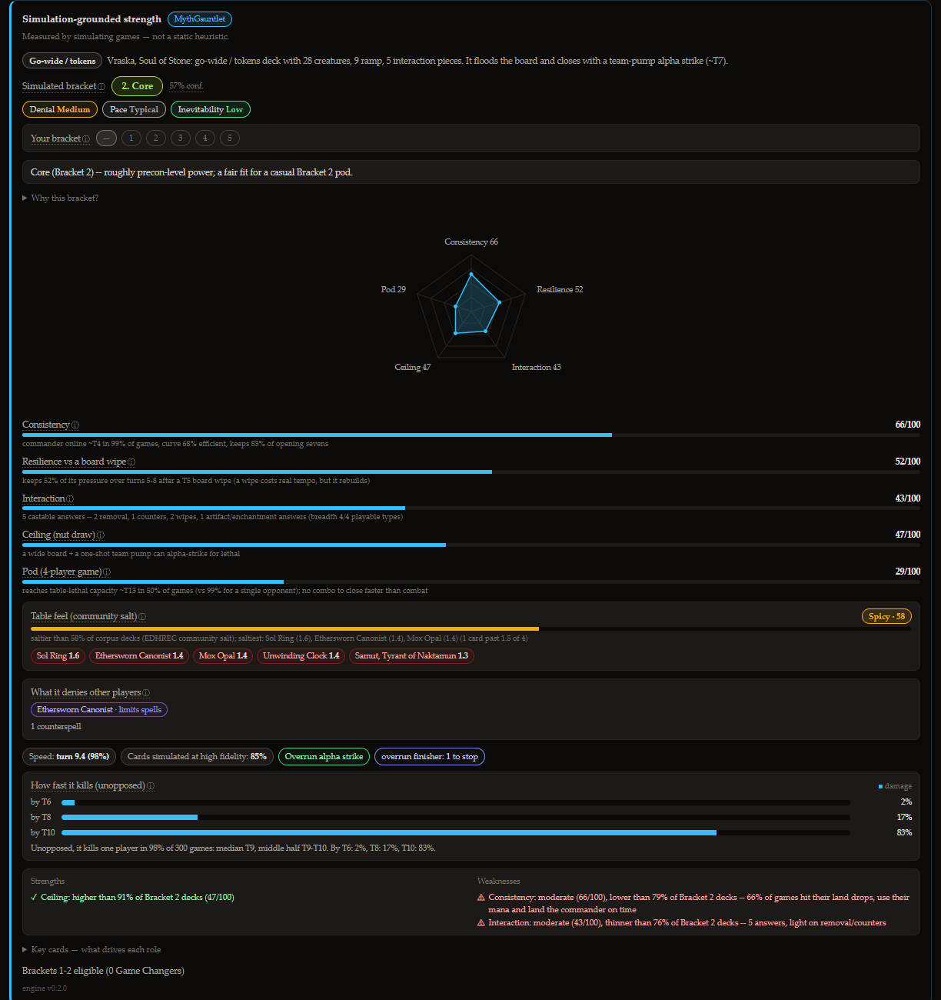

</details>

> **One analysis, no fallbacks.** If the engine isn't running, the UI says a number is unavailable
> rather than showing a second, weaker guess. It takes about 50 seconds to load the first time.

The engine's compiled card data (~32k cards) is **not in this repo**; get it with
`python download-ccm.py`. Without it the engine still runs on Oracle-text fallbacks at lower
fidelity, and the bracket estimate doesn't need it. What the download contains and its license
(CC BY-NC 4.0): [docs/ENGINE_DATA.md](docs/ENGINE_DATA.md).

---

## Importing a deck you already have

From the home screen choose **🔍 Analyze a Deck**, or switch to **📥 Import a deck** on the
Commander step.

- **Archidekt URL:** reliable.
- **Moxfield URL:** best effort (Moxfield guards its API); paste the list if it fails.
- **Pasted decklist** from ManaBox, MTGO, Deckstats, Moxfield or paper:

```text
Commander
1 Krenko, Mob Boss *CMDR*

Deck
1x Sol Ring (C21) 263
1 Goblin Chieftain
1 Skirk Prospector
30 Mountain

Sideboard
1 Goblin Bombardment
```

Quantities, `1x`, `(SET) 123` suffixes, `*CMDR*` tags and zone headers are understood; sideboard
and maybeboard are ignored. The commander is read from the commander zone, and a list without one
still imports (you can choose the face). Names that don't match a real card are listed rather than
silently dropped. Imports are cached, so re-importing the same deck makes no network calls.

**Your list is never changed** by theming, rebuilding or retheming. Only the Edit and legality-fix
tools change cards, and both save a new copy.

---

## Worked examples

### "What can I build with the cards I have?"

1. **My Collection → ⇪ Bulk import**, paste your Moxfield CSV export, choose **Merge**.
2. Open **Build from what I own**. Suppose it lists *Krenko, Mob Boss* near the top.
3. Press **🎴 Only cards I own**, pick **Bracket 2** and **Tribal**, leave AI art off.
4. The deck page opens. If your goblins ran short, a line reads like *"Collection couldn't cover:
   removal (-3)"* so you know exactly what you're missing.
5. Press **Measure strength** to see whether it really plays at Bracket 2.

### "Is my friend's deck going to stomp ours?"

1. Import both decks (Archidekt links or pasted lists). They're saved in Deck History.
2. On your deck, open **Pod check**, add your friend's deck and a third seat if you have one.
3. Read the result: a ✓ for power and pace is a good game. A **!** on pace means one deck kills
   several turns earlier than the others. A ✕ on denial usually means mass land denial or heavy
   stax in a casual pod.
4. For a closer look, run a **Head-to-head test** against their pasted list.

### "Upgrade this precon with cards I already own"

1. Import the precon list and open the deck page.
2. **Deck value** shows what it's worth and what it would cost to finish; the ownership badges show
   which cards you already have.
3. In **Upgrade advisor**, pick the axis you want to improve (or leave it on *Weakest axis*). It
   re-simulates with cards from your collection and suggests adds and matching cuts.
4. Use **✏️ Edit deck** for anything you'd rather choose yourself, then take
   it to Moxfield with the **Decklist** download.

> These walkthroughs show the flow; the commander and the numbers in them are illustrations, and
> your results depend on your collection and the decks you bring.

---

## Make it look like your world

This part is optional and needs a GPU for the custom art. Pick a commander, type a setting such as
*"a fae realm of canine trainers"* or *"Prontera City at Halloween"*, and Myth Forge invents a name
and flavor line for every card, paints new art locally, and composites it into print-ready proxy
frames. **The rules text never changes**, and every card keeps its real name as a subtitle so
nobody at the table has to guess what it is.

The same commander (Syr Gwyn, Hero of Ashvale) in four worlds. Even creature types in the rules
text ("equip **Cowboy**", "equip **Grim Warden**") follow the theme:

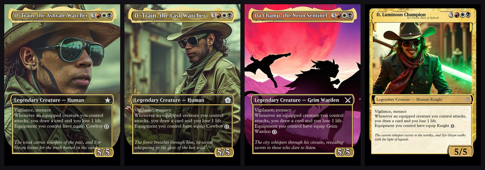

- **Theme step:** a setting line, genre/mood/lighting chips and a **Faithful ↔ Imaginative** dial.
  **🔮 Preview creative direction** shows the world, palette and sample cards before you commit;
  **🎨 Render these as real art** paints three samples first.
- **Auto-theme creature types** maps every creature type to a theme-fitting one, consistently.
- **Your face as the commander:** upload 1–5 photos and the commander (and some humanoid cards)
  render with your likeness.
- **Re-roll** art only, names and art, or reopen every setting. Or select cards and regenerate just
  those.
- **Single card:** proxy one real card with new art, or design a custom card from scratch.
- **Extras:** animated cards (MP4/WebP/GIF), a printable STL of your commander, borderless frames.

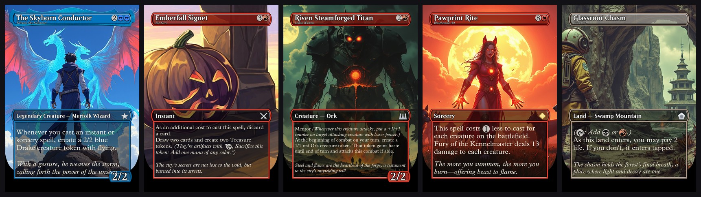

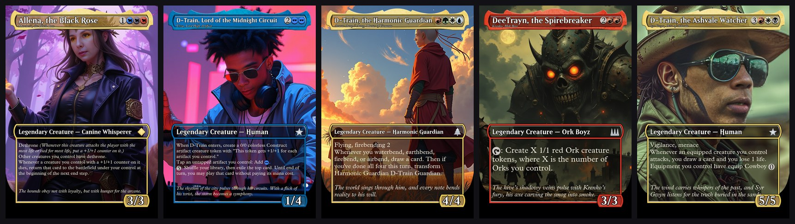

> **→ [Thirteen full themed decks in the gallery](docs/GALLERY.md)**

All art is generated locally (FLUX / SDXL via ComfyUI). Renderer, themer and image pipeline in
depth: [docs/INTERNALS.md](docs/INTERNALS.md).

---

## Requirements and services

**Deck builder and collection:** any machine that runs Python 3.10+ and a local LLM (a smaller model
or CPU is fine; [Ollama](https://ollama.ai) is the easiest start). Developed on Windows; CI runs
Python 3.12.

**Custom AI art:** developed on an RTX 3090 (24 GB). A 100-card deck takes ~18–20 min with FLUX
Schnell or ~70–75 min with FLUX Dev, using 12–14 GB of VRAM. 12–16 GB cards can run FLUX Schnell.
Smaller GPUs fall back to Scryfall art. Tuning: [docs/HARDWARE_OPTIMIZATION_GUIDE.md](docs/HARDWARE_OPTIMIZATION_GUIDE.md).

| Service | Port | Purpose | Needed for |
|---------|------|---------|-----------|
| FastAPI / Uvicorn | 8000 | The app and its API | Everything |
| Local LLM gateway | 8010 | Mentor answers, card names, flavor text, art prompts (`qwen3:14b` by default) | Theming, Mentor |
| MythGauntlet engine | 8020 | Bracket, strength, pod check, upgrade advisor | Measuring decks |
| ComfyUI | 8188 | Image generation, animation, 3D | Custom art only |

> **LLM backend.** Myth Forge talks to any **OpenAI-compatible endpoint**, by default a
> [llama-swap](https://github.com/mostlygeek/llama-swap) gateway in front of llama.cpp. Prefer
> Ollama? Set `MYTHFORGE_LLM_BACKEND=ollama`. `MYTHFORGE_LLM_BASE` overrides the URL.

### When something isn't working

| Symptom | Fix |
|---|---|
| "Port 8000 already in use" | `netstat -ano \| findstr :8000` then `taskkill /PID <pid> /F` |
| Bracket / strength says "unavailable" | The engine on :8020 is still loading (~50 s cold) or not running |
| LLM backend not detected | Install [Ollama](https://ollama.ai), `ollama pull qwen3:14b`, set `MYTHFORGE_LLM_BACKEND=ollama` |
| ComfyUI not detected | Only matters for AI art; start it via `manage.bat` → Option 3 |
| Theming worked but there's no art | ComfyUI needs `--disable-async-offload`; see [docs/INTERNALS.md](docs/INTERNALS.md#known-behaviours--gotchas) |
| Server not responding | Check the in-app **📜 Logs** viewer, or `server.log` |

More by symptom: [docs/MAINTENANCE.md](docs/MAINTENANCE.md) · launcher menu: [SCRIPTS.md](SCRIPTS.md)

---

## Documentation

**Using it**
- [INSTALL.md](INSTALL.md): install and start, step by step
- [docs/COLLECTION_MODES.md](docs/COLLECTION_MODES.md): building from your collection, and how short pools are reported
- [docs/MAINTENANCE.md](docs/MAINTENANCE.md): troubleshooting by symptom
- [SCRIPTS.md](SCRIPTS.md): the `manage.bat` menu and direct commands

**Art and printing**
- [MODELS.md](MODELS.md): checkpoints, LoRAs and face models
- [COMFYUI_SETUP.md](COMFYUI_SETUP.md): ComfyUI launch flags and VRAM
- [docs/GALLERY.md](docs/GALLERY.md): thirteen full themed decks
- [docs/INTERNALS.md](docs/INTERNALS.md): renderer, themer, image generation, faces, animation

**The engine and the code**
- [docs/ENGINE_DATA.md](docs/ENGINE_DATA.md): what engine data ships, and how to build your own
- [docs/engine/](docs/engine/): simulator architecture and card semantics
- [docs/API.md](docs/API.md): every HTTP endpoint
- [docs/DEVELOPMENT_GUIDELINES.md](docs/DEVELOPMENT_GUIDELINES.md): read before changing code
- [docs/INDEX.md](docs/INDEX.md): the full doc map

Run the tests with `python -m pytest tests -q`. CI runs the same suite plus a frontend build on every
push.

<details>
<summary><b>Project layout</b></summary>

```
mtg_deck_builder/
├── server.py                 FastAPI app: startup checks, router wiring, serves the SPA
├── api/                      HTTP routes and background build/regen/retheme jobs
├── collection*.py            Owned-card store, offline index, role pool, repair, stats
├── buildable.py              Which owned commanders could make a real deck
├── deck_builder.py           Builds the 99 by role, bracket and curve
├── deck_import.py            Moxfield / Archidekt / pasted-list import
├── deck_legality.py          Commander legality check and fix
├── deck_price.py             Deck value and cost to finish
├── deck_quality.py           Mana curve and colour sources
├── deck_themes.py            Archetypes detected from the deck's cards
├── commander_analysis.py     Reads a commander's oracle text for mechanical themes
├── playstyle.py              Playstyle presets and slot adjustments
├── bracket.py                Commander bracket definitions (1–5)
├── edhrec_lift.py            Per-commander EDHREC lift
├── scryfall_client.py        Scryfall API wrapper (rate-limited, cached)
├── themer.py                 Local LLM: themed names, art prompts, flavor text
├── image_gen.py              ComfyUI image generation and face conditioning
├── card_renderer.py          Composites print-ready proxy cards
├── exporter.py               ZIP, PDF and decklist export
├── src/mythgauntlet/         The simulation engine
├── frontend/                 React + Vite app
├── docs/                     Guides, specs and engine documentation
├── tests/                    Pytest suite
└── START MYTH FORGE.bat      Windows one-click launcher
```

</details>

---

## The Myth Suite

Myth Forge is one of three tools that share one collection file:

- **Myth Forge** *(this repo)*: collect, build, measure, theme and print.
- **MythScanner**: scan your physical cards with a webcam into the shared collection.
- **MythGauntlet**: the trained card-semantics data the engine uses.

---

## Credits & legal

Bundled frame assets are sourced from **wingedsheep/mtg-card-generator**. Card data and images come
from the **[Scryfall](https://scryfall.com)** API at runtime. Optional official-style M15 and
borderless frames are rendered from a **[Card Conjurer](https://github.com/Investigamer/cardconjurer)**
installation you supply yourself; none of that artwork is in this repo.

Myth Forge is an unofficial fan project, not produced by, endorsed by or affiliated with Wizards of
the Coast. *Magic: The Gathering* and all associated names, rules text and designs are trademarks and
copyrights of Wizards of the Coast. Cards produced by this tool are proxies for personal,
non-commercial playtesting.

No AI model weights are distributed here. You download those yourself, and several carry
non-commercial terms, so check the license of each model you install.

Code is licensed under the [MIT License](LICENSE). Full third-party attribution and the game-content
notice: [NOTICE.md](NOTICE.md).

---

## Support

Myth Forge is free, open, and runs entirely on your own machine. If it saved you a stack of proxy
cash, a coffee helps keep it improving.

<div align="center">

[](https://www.buymeacoffee.com/onemorethan0)

*Myth Forge by OneMoreThan0* ⚔️

</div>
